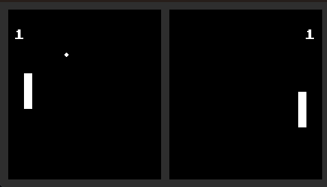

# pong
Simple Pong game implementation in Godot

The purpose of this project is to demonstrate a simple game implementation.
It demonstrates game mechanics, but is not limited to - there is fully functional UI, possibility to play with computer opponent etc.

Project starts with a basic features - setting up ball, paddle and making it work together. 
With each other addition there is more functions and these are more advanced.
Current state of the game after all tutorials is implemented in [game scene](https://github.com/marcinsendyka/pong/blob/main/game/game.tscn).

## Features

- Pong gameplay
	- Single player against simple (but effective) AI opponent
	- Two players mode
- Controller support
- Intro screen, main menu
- Remap default keybindings 
- Pause

## Running 
To run the project, Godot 4.7 is required. Just import the project into the Godot Editor and run the main scene (Game).

## In depth description

I documented some parts of the project on [small blog](https://gamedev-journal.xyz/posts/pong-project/) I created. 
Feel free to read these to learn more about node choices, explanation how / why some snippet works etc.

### Tutorials

in `tutorials/` directory you can find some sample scenes, showcasing nodes behavior. These are explained on the blog. 

1. Ball, how to create, few different options in [tutorial/ball](https://github.com/marcinsendyka/pong/tree/main/tutorial/ball). [Related blog post on gamedev-journal blog](https://gamedev-journal.xyz/posts/pong-ball/).
1. Paddle, how to create, few different options in [tutorial/paddle](https://github.com/marcinsendyka/pong/tree/main/tutorial/paddle). [Related blog post on gamedev-journal blog](https://gamedev-journal.xyz/posts/pong-paddle/).
1. Level, how to glue toghether Ball, Paddle and detect goal [tutorial/ball](https://github.com/marcinsendyka/pong/tree/main/tutorial/level). [Related blog post on gamedev-journal blog](https://gamedev-journal.xyz/posts/pong-level/).
1. HUD, display score and countdown before match. [tutorial/hud](https://github.com/marcinsendyka/pong/tree/main/tutorial/hud). [Related blog post on gamedev-journal blog](https://gamedev-journal.xyz/posts/pong/hud/).

[Pong official demo project] https://github.com/godotengine/godot-demo-projects/tree/master/2d/pong
